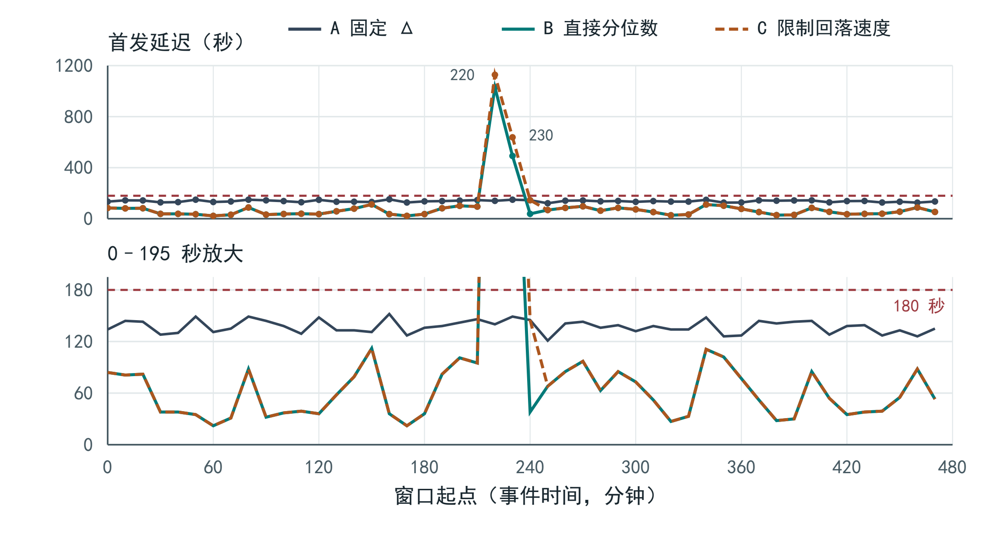

# AIS 报文回放与水位线策略实验

本项目是浙江大学海洋学院的《海洋数据挖掘》课程作业。实验使用合成的船舶自动识别系统（AIS）报文，模拟正常传输延迟和断链后的分批补传，比较三种水位线策略对窗口首发延迟和报文漏计率的影响。

## 目录结构

```text
.
├── ais_test/                         # 正式测试，种子 15403
├── ais_tuning/                       # 固定容忍量扫描和自适应策略初始对照，种子 15402
├── ais_tuning_c/                     # 策略 C 的回落速率扫描，种子 15402
├── figures/                          # 实验图表
├── README.md                         # 项目说明
├── ais_watermark_replay.py           # 合成报文生成、回放和指标统计
├── 本次对话完整聊天记录.md           # 项目讨论记录
└── 海洋数据挖掘大作业报告.docx       # 课程报告
```

## 实验方法

脚本按到达时间回放报文，并按事件时间将报文归入互不重叠的 10 分钟窗口。每到一条报文，用已见最大事件时间减去乱序容忍量 Δ，得到水位线的候选值。水位线取历次候选值的最大值，达到窗口结束时刻后发布该窗口的首次计数。

| 策略 | 乱序容忍量 Δ 的更新方式 |
| --- | --- |
| A 固定容忍量 | 整个回放过程使用同一个 Δ。 |
| B 直接分位数 | 取最近 `N` 条报文乱序深度的 `q` 分位数。乱序深度表示报文事件时间落后于此前最大事件时间的幅度。 |
| C 限制回落速度 | 使用与 B 相同的滚动分位数，并按回放的到达时间限制 Δ 的下降速度。 |

## 正式测试结果

在调参集上锁定参数后，用独立种子 `15403` 生成的报文做正式测试。延迟预算要求 P95 首发延迟不超过 180 秒，且未首发窗口数为 0。三种策略都完成了 48 个窗口的首发，离线真值共 3,219 条报文。[测试汇总](./ais_test/summary.csv)

| 策略 | P95 首发延迟（秒） | 漏计（条） | 首发漏计率 | 延迟超过 180 秒的窗口（个） |
| --- | ---: | ---: | ---: | ---: |
| A 固定容忍量 | 149 | 77 | 2.39% | 0 |
| B 直接分位数 | 112 | 82 | 2.55% | 2 |
| C 限制回落速度 | 145 | 82 | 2.55% | 2 |

首发延迟是窗口结束到首次发布的时间差。首发漏计率是首次发布时漏计的报文数占离线真值的比例。C 的首发计数与 B 逐窗一致，其中 3 个窗口的首发时间比 B 晚。[逐窗结果](./ais_test/windows.csv)



## 复现实验

使用 Python 3.10 或更新版本。脚本只依赖 Python 标准库，按固定随机种子生成输入报文。

```sh
git clone https://github.com/dzh0915/Ccean-Data-Mining.git
cd Ccean-Data-Mining
python ais_watermark_replay.py self-check
```

在仓库根目录运行下列命令，生成的 CSV 会写到 `reproduced/` 下的相应目录。

```sh
# 扫描 A 的固定容忍量并复现 B、C 的初始对照
python ais_watermark_replay.py tune --out reproduced/ais_tuning

# 扫描 C 的回落速率
python ais_watermark_replay.py tune --initial-delta-s 31 --c-rates 0.5 2 5 10 20 --out reproduced/ais_tuning_c

# 用锁定参数运行正式测试
python ais_watermark_replay.py test --fixed-delta 2 --n 100 --q 0.95 --r 5 --initial-delta-s 31 --out reproduced/ais_test
```

正式测试中，A 的固定容忍量为 2 分钟。B 和 C 的初始容忍量为 31 秒，采用最近 100 条报文乱序深度的 95% 分位数。对 C 而言，每经过 1 分钟回放时间，容忍量最多下降 5 分钟。

## CSV 文件说明

三个实验目录都包含以下文件。

| 文件 | 内容 |
| --- | --- |
| `reports.csv` | 合成报文的事件时间、到达时间、补传标记和回放阶段。 |
| `windows.csv` | 各窗口的离线真值、首发计数、首发延迟及漏计数。 |
| `trace.csv` | 逐条回放记录，包括乱序深度、容忍量和水位线。 |
| `summary.csv` | 各组参数、窗口发布情况、P95 首发延迟和首发漏计率。 |

报文和窗口的时间字段以秒为单位。`summary.csv` 中的 `first_miss_rate` 以 0 到 1 的比例记录。
